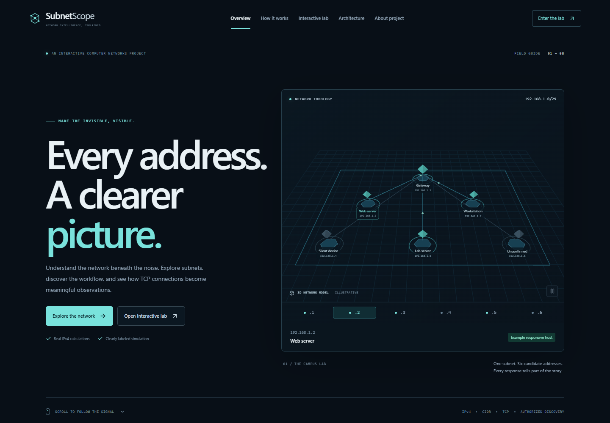
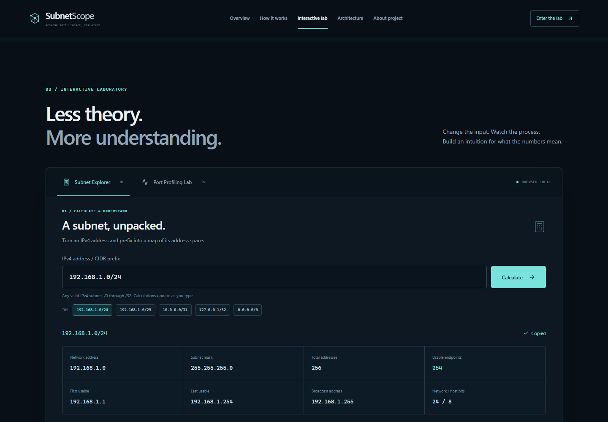
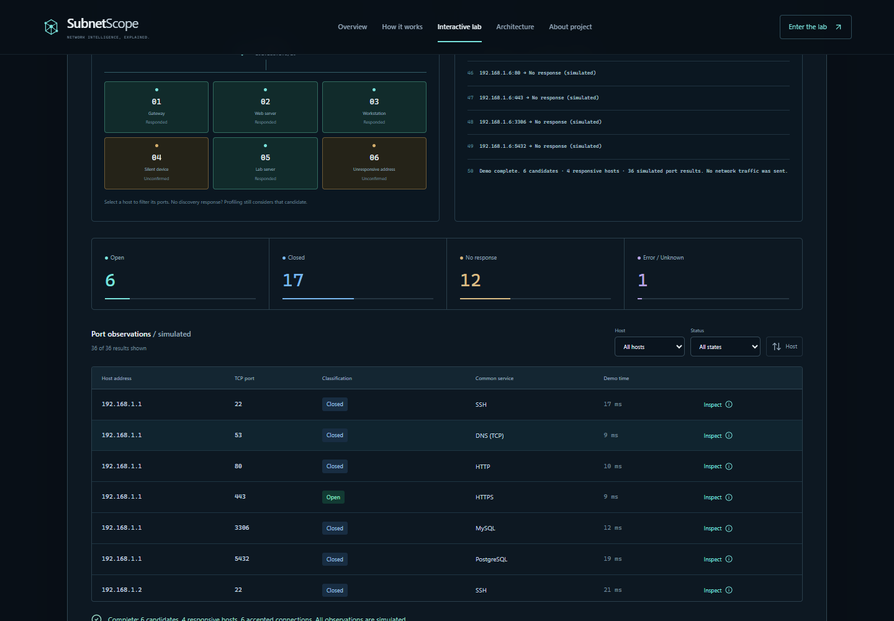

# SubnetScope

**Automated Subnet Reconnaissance and Port Status Profiling** — an interactive Computer Networks project, from IPv4 fundamentals to explainable TCP outcomes.

The public website teaches and simulates. A separate, restricted Node.js CLI performs actual TCP connection tests in an authorized private lab. The website has no scanning endpoint and never probes a visitor’s network.

## Features

- A genuine, lightweight WebGL network topology with projected host labels, inspection controls, flowing packets, and pause/resume. SVG replaces WebGL on mobile, with reduced motion, or when WebGL is unavailable.
- A progressive field guide covering networks, IPv4, CIDR, masks, address ranges, discovery evidence, TCP states, and uncertainty.
- Exactly two primary laboratory tabs: **Subnet Explorer** and **Port Profiling Lab**.
- Real IPv4 arithmetic for every prefix from /0 to /32, unsigned-safe integer calculations, live validation, a bit split, address visualization, and calculation steps.
- A deterministic /29 simulation: 6 candidates, 4 illustrative responsive hosts, and 36 port observations. Start/reset, speed control, host/status filters, sorting, result explanations, and an event timeline all work.
- An eight-stage inspectable pipeline, implementation-matched architecture, local-tool instructions, glossary, and viva questions.
- Responsive navigation, keyboard-accessible tabs, reduced-motion handling, a branded 404, favicon, and social metadata.
- A bounded local TCP utility with a dry run and optional JSON export. No database, account, API key, external service, or environment file is needed.

## Screenshots

These are actual screenshots of the local production build. Network observations displayed in them are explicitly simulated.

[Mobile overview](docs/screenshots/mobile-390.png) · [Mobile subnet results](docs/screenshots/mobile-subnet-320.png) · [Architecture](docs/screenshots/architecture.png)

## Technology

| Layer | Implementation |
|---|---|
| Application | Next.js 16 App Router, React 19, strict TypeScript |
| Visual system | Custom responsive CSS, shared tokens, Lucide icons |
| Motion | CSS sequences and IntersectionObserver scroll reveals |
| 3D | Native WebGL with explicit geometry, perspective projection, depth testing, packet motion, and resource cleanup |
| Calculation / demo | Pure TypeScript modules shared where applicable |
| Local networking | Node.js net.Socket, a bounded worker pool, finite deadlines |
| Checks | ESLint 9, TypeScript, Node’s test runner, Playwright |
| Deployment target | Vercel; no scanning backend or database |

Native WebGL and browser-native motion keep the experience small and independently testable. They replace the initially considered Three.js and animation dependencies; the result is an actual 3D scene, with an educational SVG fallback. Typography uses system fonts, so no font-provider request is required.

## Setup and local development

Use **Node.js 22.18+** (Node 24 is used for validation) and npm. Native TypeScript stripping lets the CLI and unit tests import the shared calculation module directly.

~~~sh
npm ci
npm run dev
~~~

Open http://localhost:3000. For a production preview:

~~~sh
npm run build
npm start
~~~

No .env file is required. Vercel’s automatic production/deployment URL variables are used only to resolve social metadata; local development falls back to localhost.

## Demonstration guide

1. Inspect the six example addresses in the opening topology. Pause/resume motion if desired.
2. Follow **How it works**, then select the eight pipeline stages to see each stage’s input, output, purpose, and failure modes.
3. Open **Subnet Explorer**. Try 192.168.1.0/24, then /29, /31, /32, and /0. Invalid input displays an inline explanation while retaining the last valid result.
4. Switch to **Port Profiling Lab**, choose a playback speed, and press **Start Demo**. It validates the fixed lesson subnet before replaying the candidate/discovery/probe events.
5. Filter the completed results by host or status. Sort by port, inspect an observation, and reset. Reset also cancels an in-progress run. Switching tabs resets that tab’s experiment.
6. Compare all four TCP outcomes, inspect the public/local architecture, and review the viva answers.

The demo dataset produces **6 open, 17 closed, 12 no-response, and 1 unknown** observations. These are fixture counts, not experimental network findings. All displayed demo timings are illustrative. Editing the demo subnet exercises validation; only 192.168.1.0/29 is configured. The independent calculator accepts all valid IPv4 CIDRs.

## Subnetting concepts

An IPv4 address contains 32 bits. A /p prefix selects p network bits and leaves 32 − p host bits. The address space contains 2^(32 − p) addresses. The calculator finds the network boundary using division and multiplication, avoiding JavaScript’s signed 32-bit bitwise behavior.

For a conventional /24, 2^8 = 256 addresses and 256 − 2 = 254 usable host addresses. The network and directed broadcast endpoints are reserved. The mask is 255.255.255.0.

For an RFC 3021 point-to-point /31, both addresses can be endpoints and there is no directed broadcast. A /32 represents one address, often a host route. The calculator explains both cases instead of blindly subtracting two. Calculating an address range does not establish that its addresses are assignable, routable, or authorized scan targets.

## Architecture

~~~text
PUBLIC WEBSITE                                  LOCAL NODE.JS CLI
React input / educational interface             Explicit CIDR, ports, --authorized
              |                                               |
              +--------- shared subnet.ts ---------------------+
                         parsing / arithmetic
                         candidate generation
              |                                               |
Deterministic demo.ts events                     validateScanPlan()
  candidate / discovery / TCP outcomes             full-range safety checks
              |                                               |
PortLab.tsx status table                         executeScan() bounded workers
  filters / summary / explanation                  tcpProbe() ordinary connection
              |                                               |
Browser-only simulated observations             classifier / responsive-host evidence
                                                              |
                                                Console table / optional local JSON
~~~

The CLI derives host responsiveness from accepted or explicitly refused TCP attempts. It does not make a separate ICMP discovery pass, and it profiles all candidates rather than dropping silent ones. Validation, configuration, deadlines, error handling, and source labels accompany the flow. Simulated and local results never share a store or dataset.

~~~text
src/app/                 Page, layout, styles, metadata, error and 404
src/components/          Navigation, topology, lessons, pipeline, and labs
src/lib/subnet.ts        Pure IPv4 parsing and subnet math
src/lib/demo.ts          Deterministic sample events and result operations
src/lib/network-scene.ts Native WebGL rendering and lifecycle
src/lib/content.ts       Pipeline lessons, glossary, and viva content
cli/scanner.mjs          Restricted plans, TCP attempts, and worker pool
cli/scan.mjs             Argument parsing, readable output, local export
tests/                   Unit / safety tests and browser journeys
docs/                    Verification inventory, evidence, and screenshots
~~~

The website has no API routes. CLI files are explicitly excluded from Vercel uploads as an additional separation of execution environments.

## Authorized local TCP utility

Only run real tests against devices you own or have explicit permission to test. Inspect the plan first:

~~~sh
npm run scan -- --cidr 192.168.1.0/29 --ports 22,80,443 --dry-run
~~~

A loopback test, after acknowledging authorization:

~~~sh
npm run scan -- --cidr 127.0.0.1/32 --ports 80,443 --authorized
~~~

Equivalent direct execution (the scanner has no third-party runtime dependencies):

~~~sh
node cli/scan.mjs --cidr 127.0.0.1/32 --ports 80,443 --authorized
~~~

For a controlled private lab, select the exact permitted subnet and optionally export to a local reports directory that you have created:

~~~sh
npm run scan -- --cidr 192.168.1.0/29 --ports 22,80,443 --authorized --timeout 800 --concurrency 8 --output reports/lab.json
~~~

Run npm run scan -- --help for all options. Output export refuses to overwrite existing files. Keep real reports in the ignored reports/ directory; never add local observations to the public repository or deployed site.

### Enforced restrictions

| Property | Rule |
|---|---|
| Authorization | --authorized must be explicitly present before probing; a dry run needs no acknowledgement |
| Targets | Entire subnet inside one RFC1918 block or 127.0.0.0/8; no hostnames or IPv6 |
| CIDR precision | Host bits must be clear; invalid scope is rejected rather than silently normalized |
| Address count | Maximum 14 candidate usable addresses; /28 is the largest conventional subnet allowed |
| Additional exclusions | .0 and .255 endpoints are conservatively rejected, including in /31 or /32 |
| TCP ports | Explicit subset of 22, 53, 80, 443, 3306, 5432, 8080 |
| Concurrency | Integer 1–16; default 8 |
| Per-attempt deadline | Integer 100–2000 ms; default 800 |
| Connection lifecycle | Close/destroy sockets after acceptance, refusal, timeout, or error |
| Storage | Console and user-selected local JSON only; no external transmission |

Public, multicast, unspecified, broadcast, link-local, carrier-grade NAT, and ranges crossing allowed boundaries are rejected before sockets are created. No stealth, evasion, exploits, credential attacks, application payloads, vulnerability assessment, or remote arbitrary-target API is implemented.

### Interpreting observations

- **Open:** the TCP connection was accepted.
- **Closed:** the target explicitly refused the TCP connection (ECONNREFUSED).
- **Filtered / No response:** the deadline expired without a conclusive answer. A firewall is only one possible explanation.
- **Error / Unknown:** another system or network error prevented confident classification.

An accepted connection does not identify the application or establish security. A port number is only a conventional hint. An explicit refusal is still evidence of a responsive address. No response does not prove a host is offline. DNS also uses UDP; this tool tests TCP only.

## Testing

~~~sh
npm test
npm run lint
npm run typecheck
npm run build
~~~

The dependency-free unit suite covers all prefix boundaries, malformed inputs, /24 and /29 ranges, /31 and /32 semantics, large unsigned arithmetic, deterministic events, filtering/sorting, authorization, private-range containment, disallowed targets and ports, candidate/concurrency/deadline caps, early rejection before probes, socket cleanup, and unknown errors. One integration test creates a temporary listener at 127.0.0.1:8080, checks acceptance, closes it, and checks refusal. It skips transparently if that listener cannot be created. Other private-target networking tests use injected probes and send no traffic.

Production browser journeys:

~~~sh
npx playwright install chromium
npm run build
npm run test:e2e
~~~

The browser script starts and stops its own production server at 127.0.0.1:3100. It checks the real UI at 1440, 768, 390, and 320 px, including validation, edge cases, playback, reset, filters, sorting, inspection, navigation, reduced motion, WebGL fallback, and the 404. It saves genuine screenshots in docs/screenshots/ and a machine-readable summary in docs/browser-verification.json. An existing Chrome or Edge installation can be used when bundled Chromium is absent. Set PLAYWRIGHT_EXECUTABLE_PATH to an installed browser if needed, or BASE_URL to exercise an already running site.

[QA inventory](docs/QA.md) · [Verification and publishing status](docs/VERIFICATION.md)

## GitHub and Vercel

This checkout is an isolated Git repository. Do not push it to an unrelated remote. After authenticating in the project directory:

~~~sh
gh auth login
gh repo create subnet-reconnaissance-visualizer --public --source . --remote origin --push
gh repo view --json url
~~~

Deploy the current project using Vercel’s Next.js support:

~~~sh
npx vercel@latest login
npx vercel@latest deploy --prod
~~~

Choose a **new** project named subnet-reconnaissance-visualizer if prompted. The build command is npm run build. No database, custom environment variable, or scanner server is required. Alternatively import the new GitHub repository in Vercel with the Next.js preset and project root unchanged.

Verify the returned production URL in the browser: calculate /31 and /32, finish a simulation, filter and inspect results, reset, and check the mobile menu. Do not report a URL until the deployment succeeds. This environment’s actual publication status is recorded in docs/VERIFICATION.md.

## Limitations

- The hosted website cannot discover a visitor’s LAN. All discovery events and port measurements in its lab are simulated.
- Only the supplied /29 dataset is available in the demo. The calculator is general IPv4 arithmetic.
- No application identification, IPv6, ICMP probes, UDP probes, historical comparison, or vulnerability assessment is included.
- Host discovery can be incomplete because of silent devices, firewalls, routing, packet loss, and transient failures.
- The CLI’s conservative .0/.255 exclusion intentionally rejects some technically usable /31 or /32 addresses.
- Local JSON export has no web report importer. It remains separate from the demonstration.
- 3D is replaced with SVG for small screens and reduced motion. No complete manual screen-reader audit has been performed.
- Fresh package download and remote deployment require network access; this session used locally cached packages for build verification.

## References

- [RFC 1918 — Address Allocation for Private Internets](https://www.rfc-editor.org/rfc/rfc1918)
- [RFC 3021 — Using 31-Bit Prefixes on IPv4 Point-to-Point Links](https://www.rfc-editor.org/rfc/rfc3021)
- [RFC 9293 — Transmission Control Protocol](https://www.rfc-editor.org/rfc/rfc9293)

MIT licensed. This project is an educational tool for authorized environments.
